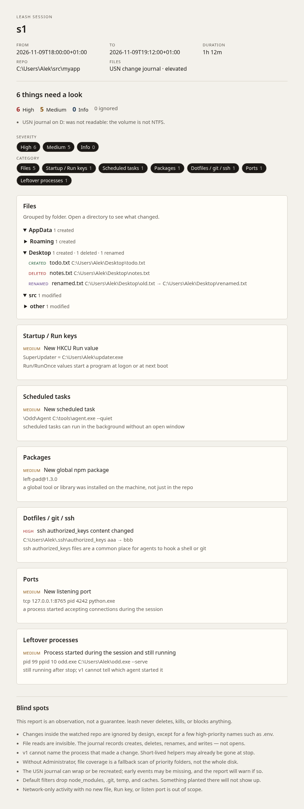

# leash

**See what your AI coding agent changed outside the repo.**

When Cursor, Claude Code, Codex or a similar agent runs on your PC, it can
change more than the project you opened. leash takes a snapshot of the machine
before the session, another one after, and shows a filtered report of what
changed *outside* that repo: files, startup entries, scheduled tasks, services,
environment variables, global packages, and listening ports.

A single Windows exe. No account, no network connection, nothing uploaded.
It is read-only: it never deletes, kills or blocks anything. Everything it
observes stays on your machine.

**v0.1 records every change on the PC during the session, not only the
agent's.** Other apps running at the same time — a browser, VS Code, Steam,
another dev server — appear in the report too. Close other apps and keep
sessions short if you want a quieter report. For per-process attribution,
run an elevated `leash run -- <agent>`, or `leash start --attach cursor`
/ `--pid`, then `leash stop`. Without that, the report stays system-wide.



## Get the preview

Windows 11, unsigned, marked as a pre-release.

[Download `leash-0.1.0-win64.zip`](https://github.com/gledach/leash/releases/tag/v0.1.0)
from the v0.1.0 pre-release, unzip it, and double-click `leash.exe`.

Windows SmartScreen will likely warn that the file is unsigned. Choose
**More info**, then **Run anyway**. A checksum is published next to the zip
(`SHA256SUMS`). Some antivirus tools may also ask the first time; that is
expected for an unsigned preview, not a sign that the tool is doing something
on the network. It is not.

## Double-click

The same `leash.exe` is the window and the command line. Opening it with no
arguments shows a small window:

1. Pick the project folder the agent will work in.
2. Press **Start**. A snapshot is written to disk, so you can close the window
   and still press **Stop** later.
3. Use the agent as you normally would.
4. Press **Stop**. The report is written, and **Open report** opens
   `report.html` in your browser.

The window remembers the last folder, lists past sessions, and has an
**Add to Start menu** button. You can also pick a running app to watch
(its process tree, when elevated). If you are not administrator, it says so
and offers **Restart as admin for full coverage and attribution**. Without
elevation, file coverage is a fallback scan of key folders; startup entries,
packages and ports still appear, and the report stays system-wide.

Diagnostic logs go to `%LOCALAPPDATA%\leash\leash.log` (small, rotated). If the
window ever closes unexpectedly, look at `%LOCALAPPDATA%\leash\crash.log`.

## Commands

From PowerShell, pass any argument and the same exe is a CLI. For a full file
diff, use an elevated window, or start PowerShell with right-click → Run as
administrator:

```powershell
cd C:\path\to\your\repo
leash doctor

# System-wide (v0.1 behaviour): every change on the PC during the session
# is listed, including other apps running at the same time.
leash start --path .
# …run Cursor / Claude / Codex as you normally would…
leash stop
leash open              # report.html in your browser
leash last              # reprint the short summary

# Recommended (elevated PowerShell): leash starts the agent itself, so
# there is nothing to pick. The report splits "your agent did this",
# "other apps changed this meanwhile", and "unattributed".
leash run --path . -- claude
# Fallback, if the agent is already running inside an editor:
leash start --path . --attach cursor
leash start --path . --pid 1234
# …then, when you are done…
leash stop
```

`leash stop` writes `report.html`, `report.json` and `report.md` under
`%LOCALAPPDATA%\leash\sessions\<id>\`. The console shows counts, up to three
High findings, and those file paths. It exits with code 1 if there is any high
finding (set `exit_on_high = false` in the config to change that).

```powershell
leash open              # report.html (default)
leash open --md
leash open --json
leash open --folder     # session folder in Explorer
leash stop --open       # also open the session folder
leash stop --verbose    # full text report in the terminal
leash report --json     # JSON on stdout
leash report --verbose
```

Aliases, if you prefer the names:

```powershell
leash snap before
leash snap after
leash diff
leash diff --json
leash diff --markdown .\leash-report.md
```

You can start a session in the window and stop it from the CLI, or the other
way around. They read and write the same sessions.


## Examples

The most reliable path is `leash run --path . -- claude` (or another agent):
leash starts it, so you do not have to pick a process. Copy-paste recipes,
including Claude in YOLO mode, Codex, Gemini and Aider, live at
<https://gledach.de/leash/examples/> and in `leash examples` (elevated
PowerShell for attribution). Attaching is the fallback when an agent is
already running inside an editor.

```powershell
leash run --path . -- claude
leash run --path . -- claude --dangerously-skip-permissions
# fallback, if it is already running:
leash start --path . --attach vscode
leash start --path . --attach cursor
```

`leash ps` lists the editors and agents leash can see, with a friendly
label, working directory, start time, pid and a command-line tail, so
several `node.exe` or `Code.exe` rows can be told apart. Agent flags
change; if one errors, check that CLI's own `--help`. The Examples page
notes which flags were current in November 2026.

## What it looks at

- File changes on NTFS/ReFS volumes, via the USN change journal when you run it
  elevated, grouped as create / delete / rename / data overwrite or extend.
- A fallback hash/mtime scan of priority folders if you are not elevated:
  profile dotfiles, `AppData\Roaming`, Startup, nearby projects.
- Registry `Run` and `RunOnce` (HKCU and HKLM).
- Scheduled tasks, Windows services, user and system environment variables
  (PATH is split into entries).
- Global npm, pnpm, pip and cargo packages, if those tools are on PATH.
- Shell profiles, `.gitconfig`, and `~/.ssh` (hashes and file names only —
  never key material).
- Listening TCP/UDP ports, with the owning process when it can be seen.
- Processes that appeared during the session and are still running (pid,
  parent, command line when available).

The report is ranked **high / medium / info**, each finding with a short reason.
Default filters drop the watched repo, `node_modules`, `.git`, `%TEMP%`,
browser and editor caches, Windows prefetch/log noise, and busy editor or
agent state folders such as `workspaceStorage`. Changes to agent
configuration still show as High: `settings.json`, `mcp.json`, `CLAUDE.md`,
Claude hooks, Codex config. A busy ignored folder is summarised as one line,
like `workspaceStorage: 42 changes`.

Rules live in a small, tested module. Copy `config/default-filters.toml` to
`%LOCALAPPDATA%\leash\config.toml` and edit it; `extra_ignore_globs` and
`extra_high_globs` append to the defaults.

The HTML report is self-contained (no network, light and dark).

## What it cannot see

Please read [docs/blind-spots.md](docs/blind-spots.md). The short version:

- Changes inside the watched repo are ignored on purpose, except for a few
  high-priority names such as `.env`.
- File reads are invisible. The journal records creates, deletes, renames and
  writes, not opens.
- Without `leash run` or `--pid` / `--attach`, the report is system-wide:
  anything else running in the same window of time shows up too.
  Attribution needs Administrator and ETW; if you are not elevated it
  stays off and says so. Work done only inside a service (Docker, msiexec,
  svchost) is labelled unattributed, not guessed. Short-lived helpers may
  already be gone by `leash stop`.
- USN journal reads need Administrator. Without it, only the fallback folders
  are scanned. `leash doctor` explains the current mode.
- The journal can wrap or be recreated between start and stop; early events
  can be missing, and leash warns when that happens.
- Non-NTFS volumes, network shares and WSL files are limited or invisible to
  the USN path.
- Registry, task and service coverage is the common persistence set, not a
  complete catalogue.
- Global package detection follows PATH. If `npm`, `pnpm`, `pip` or `cargo` is
  missing or renamed, that list is skipped and noted.
- Default filters can hide something planted in a cache or `node_modules`.
- There is no network tracing. A process that only talks to the network,
  without writing a file or opening a local listen port, is out of scope.
- leash never deletes, kills or blocks anything. It is not ransomware
  protection, not a sandbox, and not an EDR.

## Privacy

leash does not open a network connection and does not ask for an account.
Reports and logs stay under `%LOCALAPPDATA%\leash\`. SSH key files are
recorded as names and hashes, never as key material.

## Build from source

A Rust workspace. Unit tests for filters, diffs, reports and parsers run on
Linux. The Windows collectors compile behind `cfg(windows)`.

```bash
# on a Linux box, with a MinGW (or llvm-mingw) linker on PATH
cargo test --workspace
cargo clippy --workspace --all-targets -- -D warnings
cargo build --release --target x86_64-pc-windows-gnu
```

The window uses [GPUI Kit](https://gpui-kit.com/) 0.9.1.
`vendor/gpui-pre-windows` is a small patch so release builds can cross-compile
from Linux without `fxc.exe`; shaders are compiled at first launch with
`D3DCompile`. That vendored crate is Apache-2.0, from Zed Industries. See
[NOTICE](NOTICE) and [vendor/README.md](vendor/README.md).

The release binary lands at `target/x86_64-pc-windows-gnu/release/leash.exe`.
Building natively on Windows with the MSVC toolchain
(`x86_64-pc-windows-msvc`) is also fine, and is the simpler path on a
Windows 11 machine.

If you cross-compile from Linux with
[llvm-mingw](https://github.com/mstorsjo/llvm-mingw) rather than a GCC-based
MinGW, rustc still asks for `-lgcc` / `-lgcc_eh`. Run `scripts/setup-cross.sh`
after setting `LLVM_MINGW` to the toolchain prefix; `.cargo/config.toml`
already adds that compat library path. A classic `mingw-w64` GCC install does
not need the script.

There is no installer in the portable zip. An Inno Setup script lives at
`installer/leash.iss` for a later Windows build; it is not compiled in this
tree.

## Layout

```
crates/
  leash-cli          window and command line (start, stop, report, open, last, doctor)
  leash-snapshot     snapshot model, session store, diff, report
  leash-filter       ignore / priority rules
  leash-usn          USN journal via usn-journal-rs, plus fallback scans
  leash-persist      registry, tasks, services, env, ports, processes
  leash-packages     global npm / pnpm / pip / cargo
  leash-alert        empty hook for v1.5 toasts
  leash-attrib       process tree, ETW join, `leash run` / attach
config/default-filters.toml
docs/blind-spots.md
```

## Roadmap

- **Attribution (`leash run`).** Start the agent as a child, or attach to a
  running process, and use ETW to name which process made each change. The
  report splits into “your agent did this”, “other apps changed this
  meanwhile”, and “unattributed”. Needs an elevated session; the published
  v0.1.0 zip is still system-wide only, until a newer build is published.
- **v1.5 live mode.** Tail the USN journal during the session, and toast when
  lots of files are deleted outside the repo. Optional ntfy or Telegram
  delivery, still from your machine.
- **Later.** Watching reads as well as writes.

## Licence

MIT. See [LICENSE](LICENSE). Third-party notices are in [NOTICE](NOTICE).
